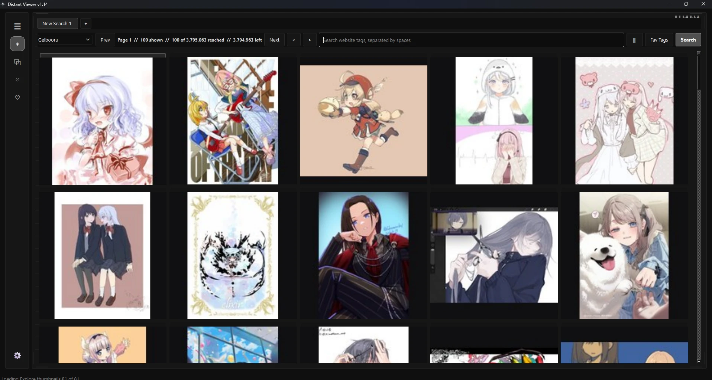
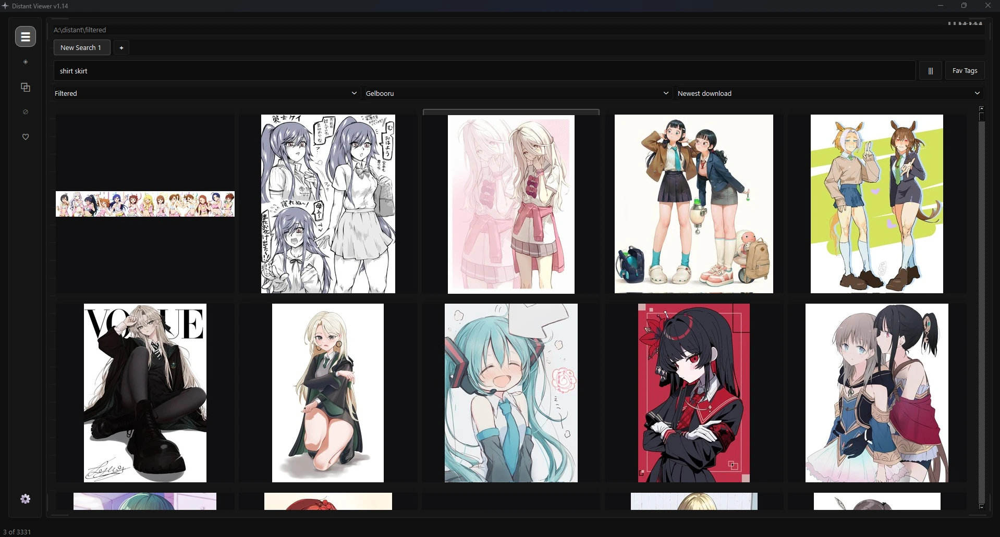
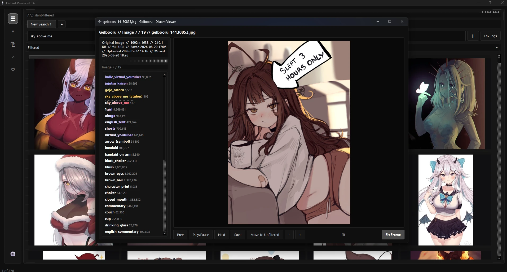
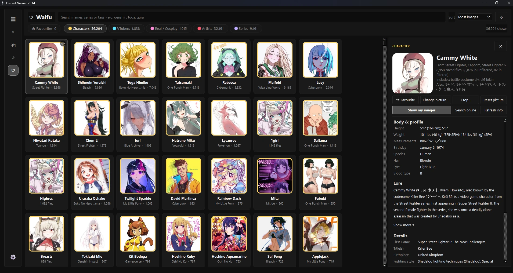
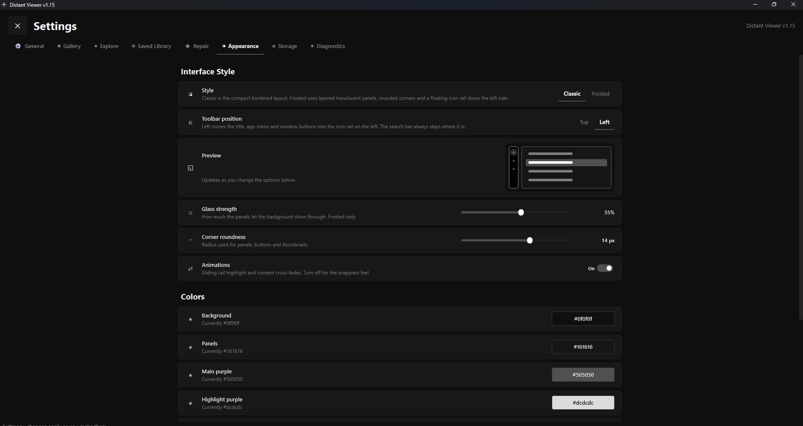

<p align="center">
  <a href="DistantViewerIcon.png"></a>
</p>

<h1 align="center">Distant Viewer</h1>

<p align="center">
  <a href="https://github.com/oscar844/Distant-viewer/releases/latest"></a>
  <a href="https://github.com/oscar844/Distant-viewer/releases/latest"></a>
  <a href="https://github.com/oscar844/Distant-viewer/releases"></a>
  <a href="https://github.com/oscar844/Distant-viewer/issues"></a>
  
  
</p>

Distant Viewer is a fast Windows app for browsing, sorting and searching a large
local image &amp; video library, and for finding and saving new media from
booru-style imageboards. It stays smooth with 100,000+ files.

> **18+ notice:** the imageboards this app can search host adult content. You are
> responsible for following each site's terms of service and your local laws.

## Download

Get `DistantViewer-<version>-windows.zip` from the
[latest release](https://github.com/oscar844/Distant-viewer/releases/latest), unzip
it, and run **Distant Viewer.exe** inside the `Distant Viewer` folder. No install
needed. Older versions are on the [releases page](https://github.com/oscar844/Distant-viewer/releases).

The app checks this page for new releases and shows a notice with the release notes
when a newer version is out. To update, download the new zip and use it in place of
the old folder - your library and settings are kept separately.

*Windows may say "Windows protected your PC" because the app isn't signed with a paid
certificate: click **More info → Run anyway**.*

## Features

### Browse your library
[](screenshot-library.webp)

- Smooth with 100,000+ images, GIFs and videos - thumbnails load only for what's on screen
- Two buckets, *Unfiltered* and *Filtered*, to sort what you keep
- Search tabs, like a browser
- Copy any image straight to the clipboard, or show it in Explorer
- Moves and deletes run in the background, so the app never freezes

<br clear="right">

### Search and sort
[](screenshot-search.webp)

- Instant tag search across the whole library
- `tag1 tag2` for both, `tag1|tag2` for either
- Colour-coded tags: artists, series, characters, general
- Sort by download date, upload date, move date, name, size or random
- Filter by site and by images, GIFs or videos

<br clear="right">

### Review and clean up
[](screenshot-viewer.webp)

- Pop-out viewer with zoom, tags and full file details
- Keyboard and mouse-button shortcuts for next, previous and delete
- A running *deleted + moved on* counter while you sort, kept until you reset it
- **Duplicate finder** that matches the same image, GIF or video across sizes and formats

<br clear="right">

### Characters, artists and series
[](screenshot-waifu.webp)

- Every character, VTuber, artist and series in your library on one page
- Pick and crop a portrait from your own images
- Profiles pulled from the web: name, series, height and more where available
- Favourites, and one click to show all your images of someone

<br clear="right">

### Explore the boorus
- Search Gelbooru, e621, Realbooru and Rule34.xxx, one site or all at once
- Middle-click to save, or **Save All From Search** for a whole result set - tags are saved with every file
- **Hidden tags**: results with tags you never want to see are skipped
- **Blacklist** posts you never want to download again

### Customize
[](screenshot-settings.png)

- Classic or frosted style, with your own colours
- Toolbar at the top or on the left
- Your own site accounts for full API access
- Repair tools that fill in missing tags and upload dates, and rebuild video thumbnails

<br clear="right">

## Supported sites

- [Gelbooru](https://gelbooru.com)
- [e621](https://e621.net)
- [Realbooru](https://realbooru.com)
- [Rule34.xxx](https://rule34.xxx)

## Site accounts

Searching works without an account, but Gelbooru and Rule34.xxx limit what their API
returns without one. To add yours, log in on the site, open **My Account > Options**
and copy your **user ID** and **API key** from **API Access Credentials** into
**Settings > Explore > Site accounts**. They are saved only on your PC
(`site_accounts.json` in the app's data folder) - never in the code.

## Where your data lives

| What | Where |
| --- | --- |
| Settings, caches, logs, site accounts | `%APPDATA%\Distant Viewer` (movable in **Settings > Saved Library**) |
| Saved images and videos | The folder chosen in **Settings > Saved Library** (with `unfiltered` and `filtered` inside) |

## Run from source

Needs Windows 10 or 11 and Python 3.12 or newer.

```bash
python -m venv .venv
.venv\Scripts\pip install -r requirements.txt
.venv\Scripts\python DistantViewer.py
```

`opencv-python-headless` and `numpy` are optional: without them, video thumbnails fall
back to Windows' own and duplicate matching skips video frames.

## Build an exe

```bash
.venv\Scripts\pip install -r requirements-build.txt
.venv\Scripts\python tools\publish.py
```

This builds `release\builds\<version>\Distant Viewer.exe` in a `release` folder next to
this repository, plus a small `release\Distant Viewer.exe` launcher that always opens
the newest build. The release notes shown in the app's update pop-up come from
`APP_UPDATE_NOTES` in `DistantViewer.py`.

## Feedback

Found a bug or have an idea? [Open an issue](https://github.com/oscar844/Distant-viewer/issues).
